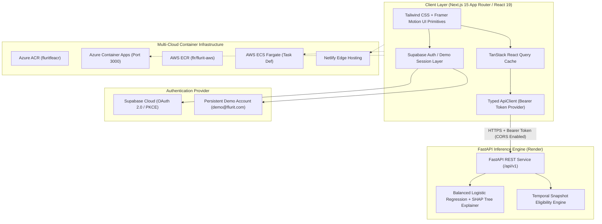

# Flurit — B2B SaaS Customer Churn & Retention Intelligence Platform

[](https://nextjs.org/)
[](https://react.dev/)
[](https://www.typescriptlang.org/)
[](https://tailwindcss.com/)
[](https://www.docker.com/)
[](https://azure.microsoft.com/)
[](https://aws.amazon.com/ecr/)
[](https://supabase.com/)
[](https://jestjs.io/)

> **Flurit** is an enterprise-grade B2B SaaS customer churn prediction, SHAP risk explainability, and revenue prioritization platform. It bridges data science with customer success operations by transforming raw subscription, billing, and telemetry histories into actionable, point-in-time retention intelligence.

---

## 🌐 Live Deployments & Endpoints

| Service | Environment / Provider | Status | URL |
| :--- | :--- | :---: | :--- |
| **Azure Container Apps** | Serverless Container (ACR) | 🟢 Live | [flurit-frontend.lemonocean-3fc98bc8.eastasia.azurecontainerapps.io](https://flurit-frontend.lemonocean-3fc98bc8.eastasia.azurecontainerapps.io) |
| **Production Frontend** | Netlify Global CDN | 🟢 Live | Deployed via CI/CD |
| **Backend Inference API** | FastAPI on Render | 🟢 Live | [flurit-backend.onrender.com/api/v1](https://flurit-backend.onrender.com/api/v1) |
| **Authentication Service** | Supabase Auth (PKCE + Google) | 🟢 Live | `mnxliofkpmhpsvoechlk.supabase.co` |
| **Container Registry (Azure)** | Azure ACR (`fluritfeacr`) | 📦 Ready | `fluritfeacr.azurecr.io/flurit-frontend:latest` |
| **Container Registry (AWS)** | Amazon ECR (`flr/flurit-aws`) | 📦 Ready | `177728328766.dkr.ecr.us-east-1.amazonaws.com/flr/flurit-aws:latest` |

---

## 📑 Table of Contents

- [Executive Summary & Problem Statement](#-executive-summary--problem-statement)
- [System Architecture](#-system-architecture)
- [Key Features](#-key-features)
  - [1. Public Marketing Website](#1-public-marketing-website)
  - [2. Authenticated Application Shell & Dashboard](#2-authenticated-application-shell--dashboard)
  - [3. Six-Stage Dataset Onboarding Pipeline](#3-six-stage-dataset-onboarding-pipeline)
  - [4. Customer Churn Risk & SHAP Explainability Explorer](#4-customer-churn-risk--shap-explainability-explorer)
  - [5. Analytics & Retention Playbooks](#5-analytics--retention-playbooks)
- [Authentication Architecture](#-authentication-architecture)
- [Multi-Cloud Containerization & Deployment](#-multi-cloud-containerization--deployment)
  - [Multi-Stage Dockerfile](#multi-stage-dockerfile)
  - [Azure Container Apps Deployment](#azure-container-apps-deployment)
  - [Amazon ECR & AWS ECS Readiness](#amazon-ecr--aws-ecs-readiness)
- [Local Development & Setup](#-local-development--setup)
- [Environment Configuration](#-environment-configuration)
- [Quality Assurance & Testing Gates](#-quality-assurance--testing-gates)
- [Repository Structure](#-repository-structure)
- [Engineering Competencies Demonstrated](#-engineering-competencies-demonstrated)

---

## 🎯 Executive Summary & Problem Statement

Modern B2B subscription businesses lose between 5% and 15% of annual recurring revenue (ARR) to silent churn. Traditional retention teams react to churn **after** cancellation notices are submitted. 

Flurit addresses this by providing an end-to-end retention intelligence platform:
* **Point-in-Time Temporal Splitting:** Ensures historical models do not suffer from data leakage or lookahead bias.
* **Non-Causal SHAP Feature Attributions:** Deconstructs machine learning predictions into human-readable risk drivers (e.g., license under-utilization, decreased session frequency, unresolved high-priority tickets).
* **ARR-Prioritized Interventions:** Ranks at-risk accounts by financial impact, enabling Customer Success Managers (CSMs) to prioritize high-value retention opportunities.

---

## 🏗 System Architecture



---

## ✨ Key Features

### 1. Public Marketing Website
* **Hero Experience:** High-converting value proposition with dynamic badge counters and interactive CTA triggers.
* **Interactive Product Preview:** Live preview of customer risk tables, telemetry breakdowns, and synthetic RavenStack benchmark telemetry.
* **Methodology Disclosures:** Clear governance notes explaining operational risk rankings vs. actuarial probabilities.
* **Fully Responsive:** Smooth navigation drawer for mobile and tablet screens.

### 2. Authenticated Application Shell & Dashboard
* **Metrics Overview:** Real-time visibility into Total ARR At Risk, High-Risk Cohorts, Model Performance (Brier score & AUC calibration status).
* **Workspace Isolation:** Context-aware workspace switcher with multi-tenant user scoping.
* **Risk Tier Distribution:** Visual distribution bars dividing accounts into High ($\ge 0.50$), Moderate ($0.35 - 0.49$), and Low ($< 0.35$) risk tiers.

### 3. Six-Stage Dataset Onboarding Pipeline
Flurit includes a comprehensive wizard that guides teams through custom dataset onboarding:

```
[1. Upload CSVs] ➔ [2. Profiling] ➔ [3. Schema Mapping] ➔ [4. Readiness] ➔ [5. Dry-Run] ➔ [6. Analysis Outcome]
```

1. **Upload CSVs:** Ingestion of customer accounts, subscription lifecycles, and feature usage telemetry.
2. **Automated Profiling:** Real-time column cardinality, missing value detection, and type inference.
3. **Canonical Schema Mapping:** Maps arbitrary user columns to required platform primitives (`account_id`, `mrr`, `contract_start`, `usage_metrics`).
4. **Data Readiness Validation:** Strict validation rules preventing invalid temporal snapshots.
5. **Dry-Run Preview:** Pre-scoring summary confirming cohort eligibility and observation dates.
6. **Analysis Outcome:** Executes backend inference, creates point-in-time snapshots, and produces operational risk distributions with one click.

### 4. Customer Churn Risk & SHAP Explainability Explorer
* **Account Risk Table:** Searchable, filterable table displaying customer accounts, MRR, churn scores, and assigned CSMs.
* **SHAP Feature Attributions:** Interactive impact charts highlighting which specific metrics increased or decreased churn probability for each account.
* **Actionable Retention Playbooks:** Suggested remediation steps (e.g., schedule QBR, offer training session, review pricing tier).

### 5. Analytics & Retention Playbooks
* **Cohort Retention Curves:** Longitudinal retention tracking across customer cohorts.
* **Churn Feature Importance:** Global feature importance charts displaying primary telemetry indicators influencing model decisions across all accounts.

---

## 🔐 Authentication Architecture

Flurit implements a production-grade, multi-tiered authentication architecture:

```
                  ┌───────────────────────────────┐
                  │          LoginForm            │
                  └──────────────┬────────────────┘
                                 │
         ┌───────────────────────┼───────────────────────┐
         ▼                       ▼                       ▼
┌──────────────────┐   ┌───────────────────┐   ┌───────────────────┐
│  Google OAuth    │   │  Email / Password │   │   Demo Account    │
│  (Supabase PKCE) │   │  (Supabase Auth)  │   │ (demo@flurit.com) │
└────────┬─────────┘   └─────────┬─────────┘   └─────────┬─────────┘
         │                       │                       │
         └───────────────────────┼───────────────────────┘
                                 ▼
                  ┌───────────────────────────────┐
                  │      AuthProvider State       │
                  │  (Persists to localStorage)   │
                  └──────────────┬────────────────┘
                                 │
                                 ▼
                  ┌───────────────────────────────┐
                  │        ApiClient Token        │
                  │   (Authorization: Bearer ...) │
                  └───────────────────────────────┘
```

* **Live Supabase Auth:** Native support for both email/password authentication and Google OAuth using PKCE (`flowType: "pkce"`).
* **1-Click Instant Demo Access:** Provides an immediate **"Explore with Demo Account"** pathway (and native support for typing `demo@flurit.com`) so reviewers, recruiters, and team members can test the entire platform without email verification roadblocks.
* **Session Persistence:** Custom localStorage session synchronization ensures page refreshes within `/app` maintain active state without flickering or unauthenticated redirects.
* **Fail-Closed Security:** In production mode without credentials, mock authentication is strictly prohibited, failing closed with clean administrator alerts.

---

## 🐳 Multi-Cloud Containerization & Deployment

Flurit is designed for containerized deployment across major cloud providers.

### Multi-Stage Dockerfile
The [`Dockerfile`](./Dockerfile) leverages a 3-stage build process optimized for size, speed, and security:

1. **`deps` stage:** Uses `node:22-alpine` with `libc6-compat` and `corepack` to install pinned `pnpm@11.5.3` dependencies with frozen lockfile validation.
2. **`builder` stage:** Builds the Next.js App Router application with production telemetry disabled and statically baked `NEXT_PUBLIC_*` arguments.
3. **`runner` stage:** Minimal Alpine production container executing under an unprivileged user (`nextjs:nodejs`, UID 1001) listening on `0.0.0.0:3000`.

### Azure Container Apps Deployment

* **Registry:** Azure Container Registry (`fluritfeacr.azurecr.io`)
* **Service:** Azure Container Apps (Serverless Consumption Environment)
* **Ingress:** External HTTP on target port `3000`

```powershell
# 1. Log in to Azure & ACR
az login
az acr login --name fluritfeacr

# 2. Build and tag image
docker build -t fluritfeacr.azurecr.io/flurit-frontend:latest .

# 3. Push to Azure Container Registry
docker push fluritfeacr.azurecr.io/flurit-frontend:latest

# 4. Deploy or update Container App
az containerapp up `
  --name flurit-frontend `
  --resource-group flurit-frontend-deploy-rg `
  --image fluritfeacr.azurecr.io/flurit-frontend:latest `
  --target-port 3000 `
  --ingress external
```

### Amazon ECR & AWS ECS Readiness

The identical Docker image is pushed and ready for AWS ECS Fargate:
* **Registry URI:** `177728328766.dkr.ecr.us-east-1.amazonaws.com/flr/flurit-aws:latest`

```powershell
# 1. Authenticate Docker with AWS ECR
aws ecr get-login-password --region us-east-1 | docker login --username AWS --password-stdin 177728328766.dkr.ecr.us-east-1.amazonaws.com

# 2. Tag image for ECR
docker tag flurit-frontend:latest 177728328766.dkr.ecr.us-east-1.amazonaws.com/flr/flurit-aws:latest

# 3. Push to AWS ECR
docker push 177728328766.dkr.ecr.us-east-1.amazonaws.com/flr/flurit-aws:latest
```

---

## 💻 Local Development & Setup

### Prerequisites
* **Node.js:** v22.13.0 or higher
* **Package Manager:** `pnpm` v11.x or v12.x (`corepack enable && corepack prepare pnpm@latest --activate`)
* **Docker:** Docker Desktop installed (for container workflows)

### Installation

```bash
# Clone the repository
git clone https://github.com/shivkantkushwaha/flurit-frontend.git
cd flurit-frontend

# Install dependencies strictly with pnpm
pnpm install

# Start the development server
pnpm dev
```

Visit [http://localhost:3000](http://localhost:3000) in your browser.

---

## ⚙️ Environment Configuration

Create a `.env.local` or `.env` file in the root directory:

```dotenv
# Backend API Base URL
NEXT_PUBLIC_API_BASE_URL=https://flurit-backend.onrender.com/api/v1

# Mock Service Worker (MSW) in local development (false = live backend)
NEXT_PUBLIC_ENABLE_MSW=false

# Supabase Authentication Configuration
NEXT_PUBLIC_SUPABASE_URL=https://mnxliofkpmhpsvoechlk.supabase.co
NEXT_PUBLIC_SUPABASE_PUBLISHABLE_KEY=sb_publishable__0SvpqLgQO11CBCLbyMSWA_MmTCkGku

# Optional legacy fallback variable
NEXT_PUBLIC_SUPABASE_ANON_KEY=
```

---

## 🧪 Quality Assurance & Testing Gates

Flurit enforces four rigorous automated quality gates:

```bash
# 1. Typecheck (TypeScript 5 strict mode)
pnpm typecheck

# 2. Linting (Next.js & React ESLint rules)
pnpm lint

# 3. Unit & Integration Testing (Jest 29 + Testing Library + MSW)
pnpm test

# 4. Production Next.js Build
pnpm build
```

### Quality Gate Results

| Test Gate | Scope | Status | Notes |
| :--- | :--- | :---: | :--- |
| **`pnpm typecheck`** | Strict TypeScript evaluation | ✅ Passed | 0 type errors |
| **`pnpm lint`** | Next.js ESLint configuration | ✅ Passed | 0 warnings, 0 errors |
| **`pnpm test`** | 10 Test Suites / 67 Tests | ✅ Passed | 100% passing across API, auth, components, onboarding, and marketing |
| **`pnpm build`** | Next.js App Router production bundle | ✅ Passed | All 12 routes statically and dynamically compiled |

---

## 📁 Repository Structure

```
flurit-frontend/
├── app/                              # Next.js 15 App Router root
│   ├── (app)/                        # Authenticated workspace routes
│   │   ├── app/                      # Overview dashboard
│   │   │   ├── analytics/            # Churn analytics & cohort tracking
│   │   │   ├── customers/            # Customer accounts & individual SHAP view
│   │   │   ├── datasets/             # 6-step dataset onboarding & ML processing
│   │   │   └── settings/             # Workspace & account settings
│   │   └── layout.tsx                # Authenticated AppShell + AuthGuard
│   ├── (auth)/                       # Authentication routes (/login, /signup)
│   ├── (marketing)/                  # Public landing page routes
│   ├── globals.css                   # Tailwind tokens & dark/light theme variables
│   ├── layout.tsx                    # Root HTML layout & fonts
│   └── providers.tsx                 # TanStack Query + AuthProvider tree
├── components/                       # Modular UI component architecture
│   ├── app/                          # App shell navigation, topbar, user menu
│   ├── auth/                         # Login, signup, AuthGuard, Google button
│   ├── brand/                        # Brand wordmark and logo SVGs
│   ├── datasets/                     # Wizard steps (Upload, Mapping, Outcome)
│   ├── marketing/                    # Hero, ProductPreview, Trust, FinalCTA
│   ├── ui/                           # Accessible UI primitives (button, card, dialog)
│   └── workspace/                    # Workspace switcher & context
├── docs/                             # Technical blueprints & audit specifications
├── lib/                              # Core business logic & SDK utilities
│   ├── api/                          # Typed API client, onboarding, predictions
│   ├── auth/                         # Supabase client, adapter, config, session
│   ├── schemas/                      # Zod validation schemas
│   ├── services/                     # Workspace data services
│   └── types/                        # TypeScript domain contracts
├── mocks/                            # Mock Service Worker (MSW) handlers for testing
├── tests/                            # Jest unit and integration test suites
├── Dockerfile                        # Multi-stage production container definition
├── docker-compose.yaml               # Local container orchestration
├── next.config.ts                    # Next.js 15 configuration
├── tailwind.config.ts                # Tailwind design system configuration
└── tsconfig.json                     # TypeScript strict configuration
```

---

## 🏆 Engineering Competencies Demonstrated

This project showcases a breadth of modern software and cloud engineering disciplines:

* **Production Next.js 15 Architecture:** Pure App Router, React 19 Server/Client component boundaries, suspense streaming, and typed layouts.
* **Cloud & Container Engineering:** Multi-stage Docker containerization, Azure Container Registry (ACR), Azure Container Apps (ACA) serverless deployment, and AWS ECR/ECS orchestration.
* **Modern Authentication & Security:** Supabase OAuth 2.0 PKCE implementation, secure token injection via bearer providers, fail-closed production boundaries, and non-root Docker execution.
* **Complex Data & ML Workflows:** Multi-step wizard state machine with real-time schema validation, type inference, SHAP tree explainability visualization, and point-in-time temporal snapshot processing.
* **Testing & Quality Assurance:** Comprehensive test coverage with Jest, JSDOM polyfills, and Mock Service Worker (MSW) request interception.

---

## 📄 License

This project is private and proprietary. All rights reserved.
