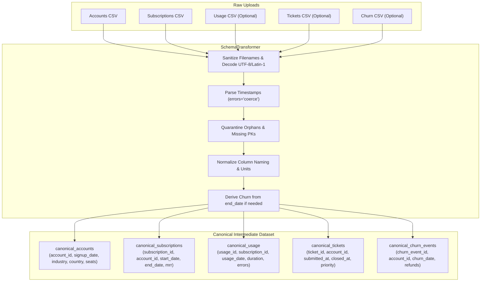
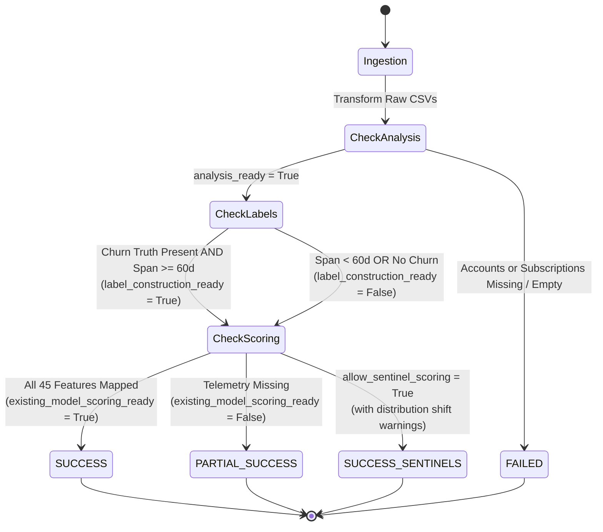

# Flurit Phase 11: Custom Dataset Processing & End-to-End Analysis Specification

## 1. Executive Summary

Phase 11 implements the complete execution layer connecting Phase 10 dataset onboarding to Flurit's point-in-time machine learning pipeline. The architecture transforms user-uploaded CSV tables and column mappings into Flurit's canonical intermediate relational format, generates time-aware customer snapshots, constructs leak-free 60-day churn targets, computes the canonical 45-feature matrix, and executes batch scoring, SHAP explainability, K-Means segmentation, and Value $\times$ Risk prioritization on compatible datasets.

### Core Architectural Principles
1. **Zero Data Fabrication**: If an uploaded dataset lacks product usage telemetry or customer support records, the pipeline never fabricates synthetic proxy features or artificial churn labels.
2. **Honest Compatibility Triad**:
   - `analysis_ready`: Relational schema integrity and mandatory customer/subscription entities are valid.
   - `label_construction_ready`: Churn ground truth and $\ge 60$-day temporal spans support future churn labeling without lookahead leakage.
   - `existing_model_scoring_ready`: Semantic compatibility across all 45 canonical features allows valid inference with the frozen Phase 6.1 champion pipeline.
3. **Graceful Degradation (`PARTIAL_SUCCESS`)**: When a dataset is capable of snapshotting and target construction but incompatible with the frozen RavenStack model, Flurit successfully generates snapshots and feature vectors while cleanly blocking inference scoring, returning exact blockers and next steps.
4. **Quarantine & Referential Safety**: Orphan contracts, unparseable dates, and duplicate identifiers are isolated into detailed rejection summaries without leaking customer PII in error messages or logs.

---

## 2. Audit of Existing Components & Architectural Gaps Closed

| Component | Pre-Phase 11 State | Phase 11 Execution Implementation |
| :--- | :--- | :--- |
| **Onboarding Profiler & Mapper** (`app/onboarding/`) | Performed static type profiling and declarative mapping previews. | Extended with `SchemaTransformer` and `DatasetProcessingEngine` to materialize normalized DataFrames in memory. |
| **Snapshot Generation Engine** (`app/ml/snapshots/engine.py`) | Hardcoded to RavenStack CSV files or fixed 2023 observation cohorts. | Generalized to dynamically compute valid historical observation dates ($T_{obs} \le T_{max} - 60\text{ days}$) from custom dataset temporal bounds. |
| **Churn Ground Truth** (`app/ml/snapshots/targets.py`) | Required a dedicated `churn_events.csv` table. | Supports derived churn ground-truth extracted directly from `subscriptions.end_date` when dedicated churn logs are absent. |
| **Feature Extraction Engine** (`app/ml/features/`) | Assumed specific RavenStack column names (`mrr_amount`, `auto_renew_flag`, etc.). | `SchemaTransformer` projects heterogeneous customer column names into canonical intermediate DataFrames before extraction. |
| **Usage-Subscription Linkage** (`app/ml/features/usage_features.py`) | Threw `KeyError` on column collision if usage table already contained `account_id`. | Hardened to drop duplicate `account_id` before merging with subscriptions, ensuring clean single-column grouping. |
| **Model Inference & Prioritization** (`app/ml/inference/`) | Supported single-vector scoring and batch payloads. | Integrated with end-to-end execution, mapping batch predictions into Value $\times$ Risk quadrants and SHAP factor attribution summaries. |

---

## 3. Canonical Intermediate Representation

The `SchemaTransformer` (`app/onboarding/transformer.py`) maps arbitrary input schemas into 5 standardized in-memory tables:



### Referential Integrity & Quarantine Rules
- **Accounts**: Records with empty `account_id`, `NaN`, or unparseable `signup_date` are dropped. Duplicates on `account_id` keep the first occurrence.
- **Subscriptions**: Subscriptions with invalid keys, unparseable `start_date`, or referencing an `account_id` not present in `canonical_accounts` are quarantined as orphans.
- **Usage & Tickets**: Records with unparseable timestamps or referencing non-existent accounts/subscriptions are excluded.
- **Rejection Summary**: The total count and sanitized rationale (e.g. `"2 subscription rows rejected due to orphaned account_ids"`) are recorded in `RecordRejectionSummary`.

---

## 4. Three-Tier Compatibility & Readiness Triad

Flurit enforces an explicit, three-tier gate before initiating pipeline execution:



### Readiness Definitions
1. **`analysis_ready: bool`**:
   - `True` if `canonical_accounts` and `canonical_subscriptions` contain valid records with primary keys and timestamps.
   - `False` if critical schema failure or all rows quarantined.
2. **`label_construction_ready: bool`**:
   - `True` if churn ground-truth is available (via `churn_events` or `subscriptions.end_date`) AND total date span $\ge \text{prediction\_window\_days}$ (60 days default).
   - Generates monthly observation snapshots with leakage-safe future churn targets in $(T_{obs}, T_{obs} + 60\text{ days}]$.
3. **`existing_model_scoring_ready: bool`**:
   - `True` ONLY if all 5 domains are mapped with real data, enabling the extraction of all 45 canonical features without synthetic fabrication.
   - `False` if usage (14 features) or support (11 features) is omitted. Scoring is blocked by default, returning `scoring_blockers` and recommended next steps.

---

## 5. End-to-End Processing Workflow

When a compatible dataset is processed (`POST /api/v1/onboarding/process`):

1. **Snapshotting**:
   Evaluates point-in-time eligibility at each approved monthly observation date $T_{obs} \le T_{max} - 60\text{ days}$. Under the approved `subscription_active` policy, accounts must have an un-terminated subscription active at $T_{obs}$.
2. **Target Construction**:
   Assigns binary target $y = 1$ if a churn event occurs in $(T_{obs}, T_{obs} + 60\text{ days}]$, $y = 0$ if customer survives throughout the window, or $y = \text{null}$ if right-censored.
3. **Feature Engineering**:
   Computes the 45-feature canonical matrix at $T_{obs}$ using only events on or before $T_{obs}$ (anti-leakage guarantee).
4. **Batch Inference**:
   Scores canonical feature records using the frozen Logistic Regression pipeline (`models/champion_pipeline.joblib`), outputting uncalibrated operational churn risk scores in $[0.0, 1.0]$ and assigning categorical risk tiers (`High Risk`, `Moderate Risk`, `Low Risk`).
5. **SHAP Factor Attribution**:
   Computes local additive feature attributions separating risk-increasing factors from risk-mitigating factors.
6. **Customer Segmentation & Value $\times$ Risk Prioritization**:
   Assigns unsupervised $K=3$ cluster identities and maps customers into portfolio quadrants (e.g., High Value - High Risk, High Value - Low Risk) to guide proactive retention interventions.

---

## 6. REST API Contracts

### 6.1 Preview Dataset Processing (`POST /api/v1/onboarding/preview`)
- **Authentication**: `Bearer <Supabase_JWT>`.
- **Content-Type**: `multipart/form-data`.
- **Form Fields**:
  - `files`: Uploaded CSV dataset files.
  - `mapping`: JSON-serialized `SchemaMappingRequest`.
  - `options` *(optional)*: JSON-serialized `ProcessingOptions`.
- **Response** (`200 OK` - `ProcessingPreviewResponse`):
  ```json
  {
    "analysis_ready": true,
    "label_construction_ready": true,
    "existing_model_scoring_ready": true,
    "total_input_rows": 24,
    "rejection_summary": {
      "total_rejected": 0,
      "rejected_by_table": {"accounts": 0, "subscriptions": 0, "feature_usage": 0, "support_tickets": 0, "churn_events": 0},
      "reasons": []
    },
    "scoring_blockers": [],
    "estimated_eligible_accounts": 4,
    "potential_observation_dates": ["2024-04-01"],
    "warnings": [],
    "next_steps": ["Review portfolio prioritization quadrants and intervention recommendations."]
  }
  ```

### 6.2 Execute End-to-End Analysis (`POST /api/v1/onboarding/process`)
- **Authentication**: `Bearer <Supabase_JWT>`.
- **Content-Type**: `multipart/form-data`.
- **Response** (`200 OK` - `EndToEndAnalysisResponse`):
  ```json
  {
    "processing_status": "SUCCESS",
    "analysis_ready": true,
    "label_construction_ready": true,
    "existing_model_scoring_ready": true,
    "scoring_blockers": [],
    "rejection_summary": {
      "total_rejected": 0,
      "rejected_by_table": {"accounts": 0, "subscriptions": 0, "feature_usage": 0, "support_tickets": 0, "churn_events": 0},
      "reasons": []
    },
    "snapshot_summary": {
      "total_snapshots": 4,
      "observation_dates_count": 1,
      "observation_dates": ["2024-04-01"],
      "eligible_accounts_count": 4,
      "positive_targets_count": 0,
      "negative_targets_count": 4,
      "censored_targets_count": 0,
      "churn_rate_pct": 0.0
    },
    "scoring_summary": {
      "scored_snapshots_count": 4,
      "model_name": "flurit_churn_predictor",
      "model_version": "1.0.0",
      "average_model_score": 0.4852,
      "high_risk_count": 1,
      "moderate_risk_count": 2,
      "low_risk_count": 1,
      "segments_distribution": {
        "High-Value Power Users": 2,
        "Low-Engagement Baseline": 2
      },
      "prioritization_quadrants": [
        {
          "quadrant_name": "High Value - High Risk",
          "priority_level": 1,
          "account_count": 1,
          "account_percentage": 25.0,
          "total_mrr": 6000.0,
          "estimated_revenue_at_risk_mrr": 3950.0,
          "action_recommendation": "Immediate executive sponsor outreach and technical account manager review."
        }
      ],
      "top_global_risk_increasing_factors": [
        {"feature_name": "usage_error_rate_30d", "mean_absolute_shap": 0.3421}
      ],
      "score_interpretation_notice": "Model Score Interpretation: Flurit model churn scores represent uncalibrated risk rankings..."
    },
    "warnings": [],
    "next_steps": ["Review portfolio prioritization quadrants and intervention recommendations."]
  }
  ```

---

## 7. Quality Gate & Test Verification

| Test Module / Check | Scope | Result | Execution Time |
| :--- | :--- | :--- | :--- |
| **`tests/test_processing.py`** | Compatible synthetic fixture, missing usage/support boundaries, temporal coverage (<60d), orphan record quarantine, anti-leakage safeguards, and REST endpoints. | **10 / 10 passed** | 2.50s |
| **`tests/test_onboarding.py`** | CSV profiler memory bounds, encoding fallbacks, PII redaction, concept mapper, and profile/map endpoints. | **22 / 22 passed** | 2.71s |
| **Full Regression Suite** | Entire Flurit backend (auth, inference, batch, persistence, segmentation, training, snapshot engine, features). | **134 / 134 passed** | 9.10s |
| **Linting Standards** | `ruff check .` across 102 files. | **All checks passed!** | 0 errors |
| **Code Formatting** | `ruff format --check .` across 102 files. | **102 files formatted** | 0 diffs |
| **Static Type Checking** | `mypy app tests scripts alembic` across 87 source files. | **Success: 0 issues** | Clean |

---

## 8. Supported Workflows & Remaining Gaps

### Supported Workflows
1. **Full 5-Domain End-to-End Processing**: Datasets with accounts, subscriptions, feature usage, support tickets, and churn events (or subscription end dates) spanning $\ge 60$ days are processed completely from raw CSVs to prioritized risk tiers.
2. **Snapshotting & Feature Engineering Only (`PARTIAL_SUCCESS`)**: Datasets with accounts, subscriptions, and churn signals but lacking usage/support telemetry generate snapshots and feature matrices with zero fabricated data, cleanly halting before model inference.
3. **Derived Churn Ground-Truth**: Subscriptions with recorded `end_date` values automatically generate derived churn events when a dedicated churn table is not uploaded.
4. **Execution Dry-Run (`/preview`)**: Lightweight structural verification without invoking computationally heavy SHAP or K-Means models.

### Remaining Architectural Gaps
1. **Automated Custom Model Retraining**: While Flurit accurately flags distribution shift and blocks scoring for datasets missing telemetry, it does not yet automatically train an ad-hoc model on the user's available features during the request.
2. **Asynchronous Background Processing for Massive Datasets**: End-to-end processing currently executes synchronously within HTTP timeouts. Uploads approaching the 500,000-row limit will require a background task queue (e.g. Celery / RQ) with job status polling or webhooks.
