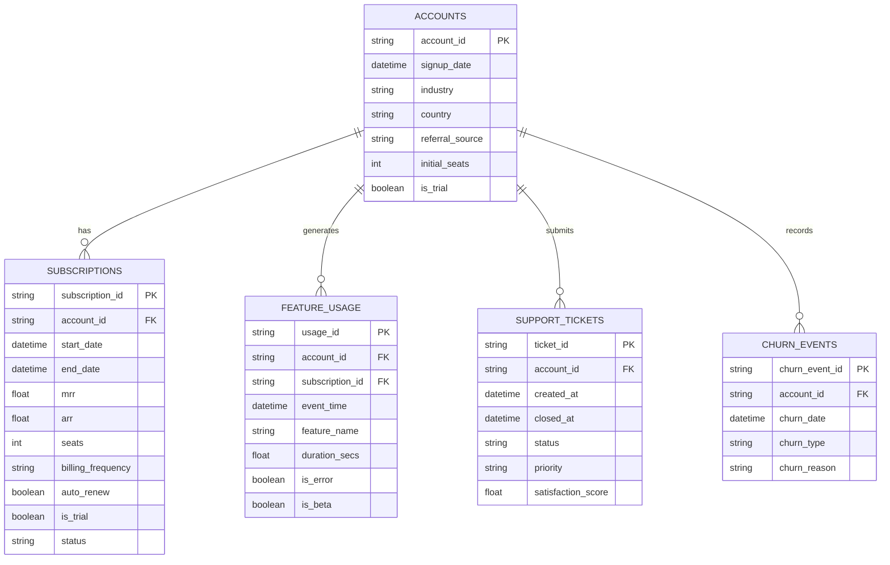

# Flurit Phase 10: Dataset Onboarding & Schema Mapping Specification

## 1. Executive Summary

Phase 10 delivers the production-ready onboarding engine enabling B2B SaaS organizations to upload, profile, map, and validate their proprietary customer datasets. The architecture decouples generic ingestion capabilities from RavenStack-specific training distributions while providing an explicit, mathematically rigorous **Readiness Assessment Engine** that classifies customer datasets as `READY`, `PARTIALLY_READY`, or `UNSUPPORTED`.

### Key Capabilities Delivered
1. **Memory-Bounded CSV Ingestion & Profiler** (`app/onboarding/profiler.py`):
   - Secure chunked streaming with configurable size limits (50 MB default) and row limits (500,000 default).
   - Multi-encoding fallback support (`utf-8`, `utf-8-sig`, `latin-1`, `cp1252`).
   - Statistical column profiling: inferred data types, null rates, uniqueness ratios, candidate identifier detection, and candidate churn target detection.
   - PII privacy protection: redaction of emails and sensitive tokens from categorical sample previews.
2. **Concept-to-Column Mapping Engine** (`app/onboarding/mapper.py`):
   - Declarative mapping against Flurit's 5 core SaaS entities: `accounts`, `subscriptions`, `feature_usage`, `support_tickets`, and `churn_events`.
   - Comprehensive cross-referencing against the canonical 45-feature schema (`app/ml/features/schema.py`).
   - Strict temporal span verification to enforce leakage-free 60-day prediction windows and historical lookback integrity.
3. **Dual-Horizon Readiness Assessment**:
   - **Target Construction Readiness**: Evaluates whether point-in-time snapshotting and future 60-day churn target construction can be executed without lookahead bias or label leakage.
   - **Model Scoring Readiness**: Evaluates whether the uploaded schema can produce all 45 canonical features required by the frozen Phase 6.1 champion pipeline, highlighting feature coverage and distribution shift risks.
4. **Versioned REST API Endpoints** (`app/api/v1/endpoints/onboarding.py`):
   - `POST /api/v1/onboarding/profile`: Multi-file CSV upload and statistical profiling.
   - `POST /api/v1/onboarding/map`: Schema mapping validation and readiness assessment report.
   - Endpoints are fully secured with Supabase JWT authentication.

---

## 2. Reusable Architecture vs. RavenStack Coupling

A central objective of the initial audit was identifying which components are universally reusable across any SaaS customer dataset and which are tied to the synthetic RavenStack distribution.

| Component | Classification | Technical Justification |
| :--- | :--- | :--- |
| **Canonical 45-Feature Schema** (`app/ml/features/schema.py`) | **Reusable** | Represents universal B2B SaaS retention concepts (tenure, MRR, usage frequency/trends, ticket volume/CSAT, prior churn history). |
| **Snapshot Generation Engine** (`app/ml/snapshots/engine.py`) | **Reusable** | Deterministic point-in-time customer eligibility logic (`subscription_active` policy) and right-censoring enforcement. |
| **Target Constructor** (`app/ml/snapshots/targets.py`) | **Reusable** | Evaluates whether a recorded churn event occurs in `(T_obs, T_obs + 60 days]`, independent of data source. |
| **Inference Preprocessing Pipeline** (`models/champion_pipeline.joblib`) | **RavenStack-Coupled** | Frozen `StandardScaler` means/stds, `SimpleImputer` statistics, and `OneHotEncoder` categories fitted exclusively on RavenStack training partitions. |
| **Explainability Artifact** (`models/explainer.joblib`) | **RavenStack-Coupled** | Background sampling and local linear coefficients calibrated to RavenStack baseline distributions. |
| **K-Means Cluster Centroids** (`models/segmenter_k3.joblib`) | **RavenStack-Coupled** | $K=3$ behavioral cluster boundaries derived from RavenStack customer volume, MRR, and activity distributions. |

> [!IMPORTANT]
> **The Model Transferability Barrier**: Arbitrary customer datasets cannot be immediately scored by the frozen RavenStack champion model with high fidelity unless all 45 canonical features are present and values align with the training distribution. Flurit safely handles partial mappings via default sentinel imputation, but explicitly flags distribution shift warnings and recommends dedicated model retraining for incomplete datasets.

---

## 3. Dataset Upload & Profiling Architecture

### 3.1 Security and Resource Bounds
To safeguard backend availability and prevent memory exhaustion attacks:
- **Chunked Stream Ingestion**: Files are read in 64 KB buffers. As soon as total cumulative bytes exceed `ONBOARDING_MAX_FILE_SIZE_BYTES` (50 MB default), the read terminates immediately and returns an HTTP 413 error.
- **Row & Column Guardrails**: Maximum 500,000 rows and 200 columns per dataset. Datasets exceeding these bounds fail fast before expensive statistical passes.
- **Directory Traversal Sanitization**: Uploaded filenames are stripped of path separators, null bytes (`\x00`), and non-alphanumeric characters using `sanitize_filename()`.
- **Zero Temporary Disk Leakage**: Profiling is executed directly from in-memory byte buffers without writing unvalidated files to the host filesystem.

### 3.2 Profiling Metrics
For each uploaded dataset, the profiler computes:
1. **Structural Metadata**: Total rows, total columns, file size, duplicate row count.
2. **Column Profiles**:
   - `inferred_type`: `integer`, `float`, `datetime`, `boolean`, `category`, `text`, or `unknown`.
   - `null_count` and `null_percentage`.
   - `unique_count` and `unique_ratio`.
   - `min_value` and `max_value` formatted as scalars.
   - `date_range`: For datetime columns, earliest date, latest date, and elapsed span in days.
3. **Role Heuristics**:
   - `candidate_id_columns`: Columns with zero nulls, near 100% uniqueness, and ID naming patterns.
   - `candidate_target_columns`: Columns with churn keywords or boolean columns with realistic churn prevalence (1% to 60%).
4. **PII Privacy Protection**:
   - Categorical sample values are inspected for RFC-compliant email patterns (`[a-zA-Z0-9_.+-]+@[a-zA-Z0-9-]+\.[a-zA-Z0-9-.]+`). Matching values are replaced with `[REDACTED_EMAIL]`. Values exceeding 50 characters are truncated.

---

## 4. Concept Mapping Specification

Flurit organizes customer retention data into 5 core SaaS concepts:

### 4.1 Concept Requirements & Sentinel Defaults

| Concept | Mandatory Fields | Optional Fields | Missing Concept Handling | Canonical Features Derived |
| :--- | :--- | :--- | :--- | :--- |
| **Accounts** | `account_id`, `signup_date` | `industry`, `country`, `referral_source`, `initial_seats`, `is_trial` | **Critical Error**: Dataset rejected as `UNSUPPORTED`. | 6 account features (`account_age_days`, profile attributes). |
| **Subscriptions** | `subscription_id`, `account_id`, `start_date` | `end_date`, `mrr`, `arr`, `seats`, `billing_frequency`, `auto_renew`, `is_trial`, `status` | **Critical Error**: Dataset rejected as `UNSUPPORTED`. | 10 subscription features (tenure, MRR, ARR, seat counts). |
| **Feature Usage** | `event_time`, (`account_id` OR `subscription_id`) | `usage_id`, `feature_name`, `duration_secs`, `is_error`, `is_beta` | **Warning**: All 14 usage features imputed with sentinels (zeros). | 14 usage features (30d/60d/90d activity, trends, error rates). |
| **Support Tickets**| `ticket_id`, `account_id`, `created_at` | `closed_at`, `status`, `priority`, `satisfaction_score` | **Warning**: All 11 support features imputed with sentinels (zeros, -1 CSAT). | 11 support features (ticket volume, priority distribution, CSAT). |
| **Churn Events** | `account_id`, `churn_date` | `churn_event_id`, `churn_type`, `churn_reason` | **Fallback**: If `subscriptions.end_date` is present, churn is derived. Otherwise target labeling is `UNSUPPORTED`. | 4 churn history features (prior events count, recency). |

---

## 5. Dataset Readiness Decision Matrix

The readiness evaluator produces separate assessments for **Target Construction** and **Model Scoring**, consolidated into an `overall_status`:

| Condition | Target Construction Readiness | Model Scoring Readiness | Overall Status | Technical Next Steps |
| :--- | :--- | :--- | :--- | :--- |
| **Full Mapping (5/5 concepts)** + Date span $\ge 150$ days | `READY` | `READY` | `READY` | Proceed to snapshot generation and batch model inference. |
| **Accounts + Subscriptions + Churn** mapped, Usage & Support missing + Date span $\ge 150$ days | `READY` | `PARTIALLY_READY` (16/45 features covered) | `PARTIALLY_READY` | Scoring possible via sentinel imputation; custom retraining recommended to avoid distribution shift. |
| **Full Mapping**, but Date span between 60 and 150 days | `PARTIALLY_READY` (truncated lookbacks) | `READY` | `PARTIALLY_READY` | 60d churn labels can be constructed, but early cohorts will have partial 90d activity histories. |
| **Date span $< 60$ days** | `UNSUPPORTED` (cannot evaluate 60d window) | Depends on features | `UNSUPPORTED` | Extend historical data collection to meet the 60-day target horizon. |
| **Missing Accounts OR Subscriptions** | `UNSUPPORTED` | `UNSUPPORTED` | `UNSUPPORTED` | Upload foundational customer and billing records. |
| **No Churn Events AND no Subscription End Dates** | `UNSUPPORTED` | Depends on features | `UNSUPPORTED` | Upload churn records or cancellation timestamps to establish ground truth. |
| **Mapped column not in dataset profile** | `UNSUPPORTED` | `UNSUPPORTED` | `UNSUPPORTED` | Correct column name mappings to match uploaded files. |

---

## 6. REST API Endpoints Specification

### 6.1 Profile Dataset (`POST /api/v1/onboarding/profile`)
- **Authentication**: Requires `Bearer <Supabase_JWT>`.
- **Content-Type**: `multipart/form-data`.
- **Parameters**: `files: list[UploadFile]` (one or more CSV files).
- **Responses**:
  - `200 OK`: `DatasetProfileResponse` containing detailed column-level profiles.
  - `400 BAD REQUEST`: Empty file, malformed CSV, or corrupt encoding.
  - `413 REQUEST ENTITY TOO LARGE`: File exceeds 50 MB limit.
  - `401 UNAUTHORIZED`: Missing or invalid JWT.

### 6.2 Map Schema & Assess Readiness (`POST /api/v1/onboarding/map`)
- **Authentication**: Requires `Bearer <Supabase_JWT>`.
- **Content-Type**: `application/json`.
- **Payload**: `SchemaMappingRequest` containing concept mappings and optional dataset profiles.
- **Responses**:
  - `200 OK`: `ReadinessAssessmentResponse` containing:
    - `overall_status`: `READY` | `PARTIALLY_READY` | `UNSUPPORTED`.
    - `target_readiness` & `target_readiness_reason`.
    - `scoring_readiness` & `scoring_readiness_reason`.
    - `feature_coverage`: Detailed breakdown of covered (up to 45), missing, and defaulted features.
    - `validation_issues`: Structured errors and warnings.
    - `recommendations` and sequential `next_steps`.
  - `401 UNAUTHORIZED`: Missing or invalid JWT.

---

## 7. Verification & Audit Trail

| Verification Step | Command / Tool | Status | Findings |
| :--- | :--- | :--- | :--- |
| **Unit & Integration Tests** | `pytest tests/test_onboarding.py` | **PASSED** (22/22) | Verified memory bounds, encoding fallbacks, PII redaction, mapping validation, and API routes. |
| **Full Regression Test Suite**| `pytest` | **PASSED** (124/124) | Zero regressions across authentication, inference, persistence, training, and snapshot engines. |
| **Linting & Code Standards** | `ruff check .` | **PASSED** (0 errors) | Strict compliance with Flurit linting rules. |
| **Code Formatting** | `ruff format --check .` | **PASSED** (0 errors) | 98 files formatted consistently. |
| **Static Type Checking** | `mypy app tests scripts alembic` | **PASSED** (0 errors) | Complete type coverage across 84 source files. |
